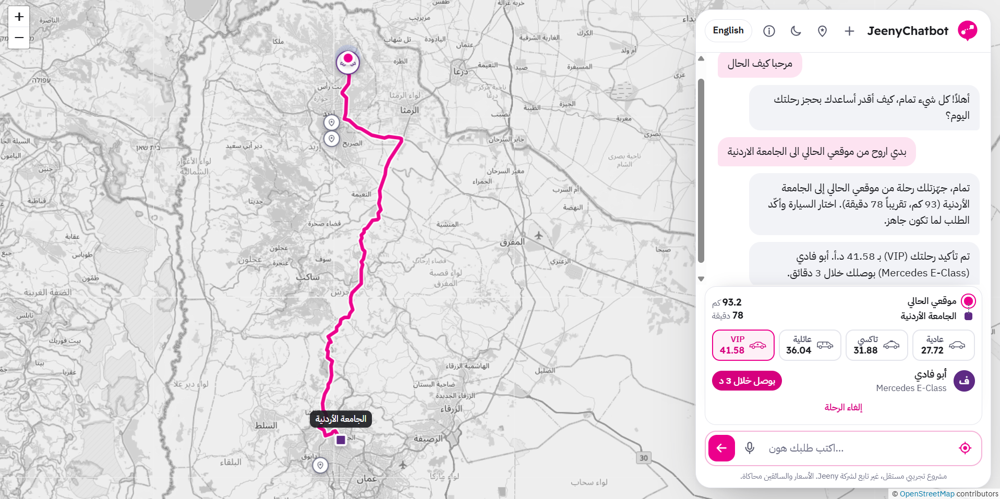
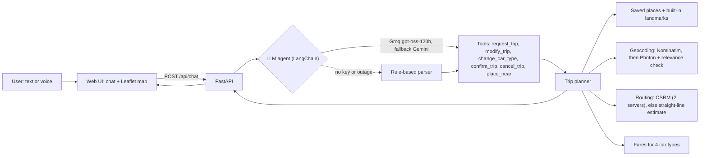

# JeenyChatbot

**A ride-booking assistant for Jordan that understands Jordanian Arabic (and English), plans the trip on a real map, and lets you confirm it — by text or voice.**

> Independent demo project, inspired by ride-hailing apps such as Jeeny. **Not affiliated with Jeeny.** Prices and drivers are simulated.

**Live demo:** [jeeny-chatbot.vercel.app](https://jeeny-chatbot.vercel.app/)


---

## The problem

Ride apps are built around forms: pick a pickup, pick a destination, pick a car. People don't talk like that. A user in Irbid says *"بدي أروح من الجامعة على البزنس بارك، وخليها VIP"* — and then changes their mind halfway: *"لا، خليها من موقعي"*.

JeenyChatbot turns that kind of conversation into a real trip: it understands the dialect, remembers what was already said, finds the places on a map, draws the route along real roads, prices four car types, and only books after the user confirms.

## What it does

- **Understands Jordanian Arabic and English**, including nicknames and missing words ("البزنس بارك" → King Hussein Business Park), and keeps context across turns: change only the pickup, only the destination, or only the car.
- **Plans real trips**: places from OpenStreetMap, routes along real roads (OSRM), distance, time and a fare for each car type (Economy, Taxi, Family, VIP).
- **Confirms before booking**: the price is shown on the confirm button and said once the ride is confirmed; a simulated driver is then assigned.
- **Handles missing places like a person would**: if a place isn't on the map it asks what's near it ("قريب من مجمع عمان") and places it there, or lets you pin it on the map. Partial matches are used but flagged: *"📍 اتأكد إن «…» هو المكان اللي بدك إياه"*.
- **Your location as pickup**: asks the browser for your location when you say "من موقعي".
- **Saved places** such as "الدار" or "الشغل", added by pinning on the map or with GPS (stored in your browser only).
- **Voice input and spoken replies** (browser Web Speech API), Arabic UI with an English toggle, light/dark theme, mobile layout.
- **Keeps working without AI**: if no LLM key is set, or the free tier is exhausted, a rule-based parser takes over.

## How it works



1. The browser sends the message plus the current trip, saved places and (if shared) the user's location. The server keeps no session state, which suits serverless hosting.
2. The agent reads the message and calls **one tool** with the details it understood (pickup, destination, car type, and the place's official name as a search hint). Tools return their reply directly, so a turn usually needs a single model call.
3. The trip planner resolves places (saved places → built-in landmarks → OpenStreetMap search near the user), checks that the map result really matches what was asked, routes the trip and prices it.
4. Buttons on the trip panel (car type, confirm, cancel, use my location, pin on map) call the planner directly — no LLM call, instant.

## Tech stack

| Layer | Tools |
|---|---|
| Language understanding | LangChain 1.x `create_agent` with tool calling and model fallback; Groq (`openai/gpt-oss-120b`) and Google Gemini through OpenAI-compatible APIs; rule-based fallback with regex + fuzzy matching (rapidfuzz) |
| Backend | Python 3.11+, FastAPI, Pydantic v2, httpx |
| Maps | OpenStreetMap: Nominatim and Photon (geocoding), OSRM (routing), OSM tiles; Leaflet in the browser |
| Frontend | Plain HTML/CSS/JavaScript (no build step), Web Speech API, RTL/LTR i18n |
| Quality | pytest (offline: fake LLM, fake maps), an evaluation script with a 50-message test set |
| Deployment | Vercel (zero-config FastAPI) — free tier, no credit card |

Everything runs on free tiers without a credit card.

## Results

Only numbers from real runs are reported here.

| What | Result | How it was measured |
|---|---|---|
| Understanding, **AI mode** (Groq `openai/gpt-oss-120b`) | **94.0%** exact match (47/50) · action 98.0% (49/50) · places 91.2% (31/34) · car type 100% (29/29) | `python scripts/evaluate.py --mode ai` on `data/eval_set.jsonl`, after error analysis (see below) |
| AI mode speed | median 1.08 s · p95 3.30 s per message · 1.0 model call per message | same run (Groq free tier, called from a PC in Jordan) |
| Understanding, **rule-based mode** (no AI) | **88.0%** exact match (44/50) · action 96.0% (48/50) · places 88.2% (30/34) · car type 93.1% (27/29) | `python scripts/evaluate.py --mode rules` |
| Rule-based speed | p95 0.001 s per message | same run |
| Automated tests | 119 passing | `python -m pytest` |

The evaluation measures **language understanding** only: maps are faked during evaluation, so the score doesn't depend on OpenStreetMap coverage or network speed. "Exact match" means the action, pickup, destination and car type are all right. An empty pickup and "my location" count as the same answer, because the app treats them the same way.

**Error analysis.** The first AI run scored 86.0% exact match (43/50; places 79.4%). Reading the seven misses showed:
- a tool that the prompt mentioned but the request didn't include, so the provider rejected the call;
- the model shortening "الجامعة الأردنية" to "الجامعة", which is also the name of a saved place (a different university);
- role words such as "الوجهة" left inside place names;
- a scoring rule that counted "my location" and an empty pickup as different answers.

After fixing these, the second run scored 94.0%. Because the fixes came from this same set, it is a development set rather than a held-out test. The remaining misses are small spelling slips by the model (عبدون → عبدن, الرمثا → الرمثة) and one reply in text where a tool call was expected; LLM output also varies from run to run.

Example routes from real runs (OSRM): Irbid → Amman 95.1 km / 72 min · Irbid → Queen Alia Airport 122.7 km / 106 min.

### Evaluation data (sample)

50 hand-written messages (38 in Jordanian Arabic, 12 in English): 24 new trips, 10 changes to an existing trip ("غير الوجهة للبزنس بارك"), 5 car-type changes ("خليها VIP"), 3 confirmations, 2 cancellations and 6 other messages (greetings, questions).

| id | message | expected action | pickup | destination | car |
|---|---|---|---|---|---|
| 1 | بدي أروح من إربد على عمان | new_trip | اربد | عمان | – |
| 3 | وصلني من الدوار السابع لمطار الملكة علياء | new_trip | الدوار السابع | مطار الملكة علياء | – |
| 4 | بدي تكسي من وسط البلد لتاج مول | new_trip | وسط البلد | تاج مول | taxi |
| 5 | بدنا سيارة عائلية من السلط لعجلون، احنا ستة | new_trip | السلط | عجلون | family |
| 6 | احجزلي VIP من العبدلي للمطار | new_trip | العبدلي | المطار | vip |

## Project structure

```
JeenyChatbot/
├── app.py                  # entry point (Vercel and uvicorn)
├── jeenychatbot/
│   ├── api.py              # FastAPI routes, rate limiting
│   ├── service.py          # one chat turn: agent first, rules as fallback
│   ├── agent.py            # LangChain agent, system prompt, tools
│   ├── actions.py          # what the assistant can do (shared by AI, rules and UI buttons)
│   ├── trips.py            # resolve places, route, price, confirm
│   ├── geocoding.py        # Nominatim + Photon, relevance check, cache
│   ├── routing.py          # OSRM with a second server and an estimate fallback
│   ├── fallback_parser.py  # rule-based understanding
│   ├── places.py, text.py  # landmarks, saved places, Arabic normalization
│   ├── pricing.py, driver.py, messages.py, models.py, llm.py, config.py, cli.py
├── public/                 # web UI: index.html, app.js, i18n.js, styles.css, Leaflet
├── data/
│   ├── places.json         # built-in landmarks (cities, universities, malls, airports)
│   └── eval_set.jsonl      # the 50-message evaluation set
├── scripts/                # evaluate.py, check_llm.py, build_places.py
├── tests/                  # pytest, fully offline
├── requirements.txt, requirements-dev.txt, vercel.json, .env.example
```

## Run it locally

Requires Python 3.11 or newer.

```bash
git clone https://github.com/anaskasasbeh/JeenyChatbot.git
cd JeenyChatbot
python -m venv .venv
source .venv/Scripts/activate        # Windows (Git Bash). macOS/Linux: source .venv/bin/activate
pip install -r requirements-dev.txt
cp .env.example .env                 # optional: add a free Groq key (see below)
python -m pytest                     # all tests run offline
uvicorn app:app --reload             # open http://127.0.0.1:8000
```

Terminal chat instead of the web UI: `python -m jeenychatbot` (add `--rules` to skip the LLM).

**AI keys (optional, free, no credit card):**
- Groq → https://console.groq.com/keys → put it in `LLM_API_KEY`
- Google AI Studio (fallback) → https://aistudio.google.com/apikey → `FALLBACK_LLM_API_KEY`
- Check them with `python scripts/check_llm.py`

Without keys the app runs in rule-based mode and says so in the UI.

## Deploy (Vercel)

1. Import the GitHub repository at https://vercel.com/new (framework is detected automatically).
2. Add the environment variables from `.env.example` (at least `LLM_API_KEY`) in the project settings.
3. Deploy. `public/` is served by Vercel's CDN; `app.py` runs as a Python function.

## Limitations

- **Map coverage**: OpenStreetMap is free but has fewer shops and malls than Google Maps. Missing places are handled by asking what's near them or by pinning them on the map.
- **Public map servers**: Nominatim allows about one request per second and the public OSRM servers are for light use — fine for a demo, not for production traffic.
- **Simulated booking**: fares follow a made-up tariff, and drivers are generated near the pickup.
- **Small evaluation set**: 50 messages written by the developer; real user messages would be more varied.
- **Voice** depends on the browser's speech recognition (best in Chrome and Edge); laptop location is approximate.
- **Rate limiting** is kept in memory, so separate serverless instances don't share it.

## Future work

- A larger evaluation set built from real, anonymized conversations.
- An optional extra place-search provider with better shop coverage.
- A draggable pickup marker to correct an inaccurate location.
- Streaming replies.

## License and credits

MIT License — see [LICENSE](LICENSE).

Map data © [OpenStreetMap](https://www.openstreetmap.org/copyright) contributors. Routing by [OSRM](https://project-osrm.org/). Map display by [Leaflet](https://leafletjs.com/).

Built by **Anas Kasasbeh** — AI Engineer, Jordan · [LinkedIn](https://www.linkedin.com/in/anaskasasbeh)
